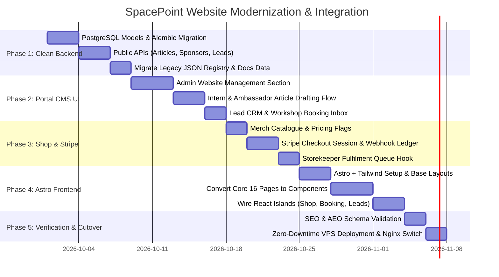

# SpacePoint Main Website — Audit & Unified Architecture Handoff

**Entry point and architectural blueprint for the official SpacePoint public website (`spacepoint.ae`) and its migration into the Unified SpacePoint Platform.**

---

## 1. Executive Summary & Legacy Audit

The legacy repository (`officialspacepoint-main.zip`) contains the public-facing marketing and community website for SpacePoint. 

While visually striking (featuring custom deep-space styling `#05030A`, glassmorphic violet cards, canvas starfields, shooting stars, and a rocket scroll-to-top animation), the underlying implementation is heavily burdened by legacy technical debt and completely disconnected from the SpacePoint Unified Platform (`portal.spacepoint.ae`).

### Technical Debt in the Legacy Codebase

1. **Flat-File JSON Storage & Brittle SSG Mechanics**:
   - Articles are stored in a raw JSON file (`admin_backend/models/blogs_registry.json`).
   - Publishing an article does not use a database. Instead, a Jinja2 template (`article_template.html`) compiles a physical static file (`articles/article{id}.html`) directly on disk, and rewrites the HTML inside `blog.html` between string delimiters (`<!-- ARTICLE CARDS START -->` ... `<!-- ARTICLE CARDS END -->`).
   - Markdown parsing is handled by fragile regular expressions (`re.sub(r'\*\*(.*?)\*\*', ...)`) in Python that break on multiline blocks, complex lists, or nested formatting.
2. **Insecure, Isolated Admin Backend**:
   - The admin panel runs as an independent FastAPI instance on port `8004` (separate from the main portal on port `8000`).
   - Authentication is a single shared plaintext string (`SpacePoint2026!`) setting a static cookie (`admin_auth_token=super_secret_auth_token_for_spacepoint`).
   - 3 of the 4 tabs on the dashboard (**Case Studies**, **Media Coverage**, and **People Directory**) are purely decorative mockups displaying *"Module Under Development"*.
3. **Form Submissions Routed to Google Forms**:
   - The workshop booking wizard (`book-workshop.html`), product waitlist (`shop.html`), newsletter popups, and research modals all submit to unmonitored external Google Forms via hidden iframes (`target="hidden_iframe"`).
   - High-value commercial leads and student inquiries are not captured in the company's CRM or contact database (`Spine`).
4. **Maintenance Duplication (16 Static HTML Files)**:
   - Pages (`index.html`, `about.html`, `programs.html`, `shop.html`, etc.) are individual static HTML files.
   - Global elements (desktop navigation, mobile slide-out drawer, footer links, legal modals) are copy-pasted across all 16 files.
   - Any menu update required running a regex find-and-replace script (`scripts/update_nav.py`).
5. **Disconnected Mock Shop**:
   - The shop (`shop.html`) displays 6 hardcoded products with "Coming Soon" badges.
   - Products are not connected to the platform's existing inventory catalogue (`Item`), real stock is not tracked, and payments are not wired to Stripe.

---

## 2. Legacy Repository Inventory

```
SpacePoint-LandingPage/
├── index.html                    # Homepage (Hero, 3D CubeSat, Impact, Marquees, Globe, FAQ, Testimonials)
├── about.html                    # Mission, vision, core pillars, team overview
├── programs.html                 # 4 educational tiers: Quick Flight, Shallow Flight, The Mission, The Journey
├── book-workshop.html            # Multi-step school & university workshop booking form (Google Forms proxy)
├── shop.html                     # Ground Station store (6 mock products with waitlist modal)
├── blog.html                     # Dynamic blog index with category filter tabs
├── case_studies.html             # Impact reports on university & school CubeSat workshops
├── student_mission.html          # Showcase of 6 real student-led engineering projects
├── journey.html                  # SpacePoint timeline & historical milestones
├── team.html                     # Leadership, instructors, and aerospace engineers
├── alumni.html                   # Program graduates and their career trajectories
├── ambassadors.html              # Global ambassador directory with SVG country flags
├── media_coverage.html           # Newspaper clippings (Khaleej Times, Gulf News, Wam) with RTL Arabic support
├── our_platforms.html            # Hub linking Africa LMS, Space Industry LMS, and Portal
├── resources.html                # Media kit, vector logos, and 6 monthly PDF newsletter issues
├── template.html                 # Clean boilerplate layout with header, canvas, and footer
├── uae.svg                       # UAE national flag vector
├── robots.txt & sitemap.xml      # Search crawler priority maps
│
├── admin_backend/                # Standalone FastAPI MVC panel (to be retired)
│   ├── main.py                   # Entry point running on port 8000/8004
│   ├── controllers/
│   │   └── blog_controller.py    # Login, publish, edit, delete, reorder endpoints
│   ├── models/
│   │   ├── blog_model.py         # JSON storage handlers & blog.html string-replacement rebuilder
│   │   ├── blogs_registry.json   # Datastore storing 3 existing articles
│   │   ├── article_template.html # Jinja2 HTML layout for generated article files
│   │   └── init_registry.py      # Scraper to parse legacy HTML into JSON
│   └── views/
│       ├── admin_panel.html      # Control room (3 placeholder tabs)
│       └── login.html            # Admin login screen
│
├── articles/                     # Statically generated article pages (article1.html - article3.html)
├── assets/
│   ├── css/style.css             # Space theme, canvas, nebula gradients, flip cards, rocket animation
│   ├── js/script.js              # Starfield canvas, shooting stars, modal triggers, rocket launcher
│   ├── docs/                     # Issues 1 to 6 monthly newsletter PDFs (~18 MB)
│   └── img/                      # Branding, product photos, CubeSat renders, team/partner logos
│
├── scripts/
│   └── update_nav.py             # Regex script to sync navigation across all 16 HTML pages
├── SEO/
│   └── AEO.md                    # Strategic brief: keywords, GA4 (G-LZSXTHGZW0), JSON-LD schemas
├── Students Projects/            # Raw .docx source docs and high-res photos for 6 student missions
├── deployment_guide.md           # VPS deployment documentation (systemd + Nginx)
├── version_control.md            # Technical changelog (v1.0.0 through v1.4.0)
└── README.md                     # Legacy architectural overview
```

---

## 3. Target Modern Architecture

We completely retire the legacy `admin_backend` and the flat-file/regex mechanics. The platform is divided into two cleanly separated layers:

```
┌────────────────────────────────────────────────────────────────────────┐
│                        PUBLIC FRONTEND (spacepoint.ae)                │
│  Astro 5 + Tailwind CSS (100% Static HTML/CSS, 0 KB Runtime JS)       │
│  React Islands (client:visible) for Stripe Shop & Booking Wizard       │
│  Cached CDN / Nginx Static Delivery (100/100 Lighthouse & AEO Score)   │
└───────────────────────────────────┬────────────────────────────────────┘
                                    │ Public Read APIs & Form Submissions
                                    ▼
┌────────────────────────────────────────────────────────────────────────┐
│                   SHARED BACKEND (portal.spacepoint.ae:8000)           │
│  FastAPI (async) + SQLAlchemy 2 + PostgreSQL 16 + Alembic              │
│  Existing Services: Stripe Checkout, Inventory Ledger, Storage, ARQ   │
│  New Routers: /public/* (articles, shop, leads), /cms/* (management)   │
└───────────────────────────────────┬────────────────────────────────────┘
                                    │ Management & Authoring
                                    ▼
┌────────────────────────────────────────────────────────────────────────┐
│                   PORTAL ADMIN CMS (portal.spacepoint.ae)              │
│  React 19 + TanStack Router + Radix UI + Lucide                        │
│  Admin/Ops: Website CMS (Articles, Sponsors, Media, Lead CRM)          │
│  Interns / Ambassadors: Role-based article drafting & review queue     │
└────────────────────────────────────────────────────────────────────────┘
```

---

## 4. Backend Modernization: Clean Domain Models

Instead of writing to `.json` and compiling `.html` files to disk, all dynamic website entities become standard, first-class SQLAlchemy models in the PostgreSQL database.

### 4.1 Articles Domain (`app/models/cms/article.py`)

Replaces `blogs_registry.json` and `article_template.html`:

```python
class Article(Base):
    __tablename__ = "articles"

    id = Column(UUID(as_uuid=True), primary_key=True, default=uuid.uuid4)
    slug = Column(String(160), nullable=False, unique=True, index=True)
    title = Column(String(255), nullable=False)
    summary = Column(Text, nullable=False)
    content_markdown = Column(Text, nullable=False)
    content_html = Column(Text, nullable=False)  # Compiled with markdown-it/Bleach sanitization
    category = Column(String(64), nullable=False, default="TECHNOLOGY", index=True)
    
    # Author association: Links to a real user account in the Portal
    author_id = Column(UUID(as_uuid=True), ForeignKey("users.id", ondelete="SET NULL"), nullable=True)
    author_display_name = Column(String(128), nullable=False)
    author_role = Column(String(128), nullable=False)
    author_initials = Column(String(8), nullable=False)
    
    # Media & SEO
    cover_image_url = Column(String(512), nullable=True)
    meta_description = Column(String(255), nullable=True)
    
    # State Machine: draft -> in_review -> published -> archived
    status = Column(String(32), nullable=False, default="draft", index=True)
    featured_order = Column(Integer, nullable=True)  # For custom homepage/blog pinning
    published_at = Column(DateTime(timezone=True), nullable=True)
    created_at = Column(DateTime(timezone=True), default=lambda: datetime.now(timezone.utc))
    updated_at = Column(DateTime(timezone=True), onupdate=lambda: datetime.now(timezone.utc))
```

### 4.2 Sponsors & Partners Domain (`app/models/cms/sponsor.py`)

Powers the four marquee sliders on the homepage dynamically:

```python
class Sponsor(Base):
    __tablename__ = "sponsors"

    id = Column(UUID(as_uuid=True), primary_key=True, default=uuid.uuid4)
    name = Column(String(128), nullable=False)
    logo_url = Column(String(512), nullable=False)
    website_url = Column(String(512), nullable=True)
    # Tier groups: "client" | "partner" | "supporter" | "academic"
    tier = Column(String(32), nullable=False, default="partner", index=True)
    display_order = Column(Integer, nullable=False, default=0)
    is_active = Column(Boolean, nullable=False, default=True)
```

### 4.3 Press & Media Coverage (`app/models/cms/media_clipping.py`)

Replaces the hardcoded press clippings on `media_coverage.html`:

```python
class MediaClipping(Base):
    __tablename__ = "media_clippings"

    id = Column(UUID(as_uuid=True), primary_key=True, default=uuid.uuid4)
    publisher_name = Column(String(128), nullable=False)  # e.g., "Khaleej Times", "Gulf News"
    article_title = Column(String(255), nullable=False)
    article_url = Column(String(512), nullable=False)
    published_date = Column(Date, nullable=False)
    logo_url = Column(String(512), nullable=True)
    is_arabic = Column(Boolean, nullable=False, default=False)
    snippet = Column(Text, nullable=True)
    display_order = Column(Integer, nullable=False, default=0)
```

### 4.4 Leads & Workshop Bookings (`app/models/crm/lead.py`)

Replaces all external Google Forms submissions:

```python
class Lead(Base):
    __tablename__ = "leads"

    id = Column(UUID(as_uuid=True), primary_key=True, default=uuid.uuid4)
    # "workshop_booking" | "newsletter" | "product_inquiry" | "general"
    lead_type = Column(String(32), nullable=False, index=True)
    contact_name = Column(String(128), nullable=True)
    email = Column(String(255), nullable=False, index=True)
    phone = Column(String(32), nullable=True)
    organization_name = Column(String(128), nullable=True)
    program_interest = Column(String(64), nullable=True)  # Quick Flight, The Mission, etc.
    details = Column(JSONB, nullable=True)  # Student counts, location, requested dates
    status = Column(String(32), nullable=False, default="new")  # new | contacted | converted | closed
    created_at = Column(DateTime(timezone=True), default=lambda: datetime.now(timezone.utc))
```

---

## 5. Shop, Inventory Ledger & Stripe Checkout

### 5.1 Extending the Existing Inventory `Item` Model
The portal already possesses an inventory catalogue (`backend/app/models/inventory/item.py`) with `category="merch"` and variant groupings (`variant_group`, `variant_label`). We add e-commerce attributes directly:

- `is_for_sale`: `Boolean(default=False)`
- `price_cents`: `Integer` (in minor units, e.g., 2000 = 20.00 AED)
- `currency`: `String(3, default="AED")`
- `shop_description`: `Text`
- `shop_images`: `ARRAY(String)` (served via Cloudflare R2 / S3 storage facade)

### 5.2 Stripe Checkout & Automatic Stock Deduction
When a user purchases merchandise on `shop.html`:
1. Customer initiates purchase $\rightarrow$ Backend generates a Stripe Hosted Checkout Session (`allow_promotion_codes=True`).
2. Webhook listener (`POST /public/shop/webhooks/stripe`) listens for `checkout.session.completed`.
3. The backend executes a unified transaction:
   - Creates a `ShopOrder` record with shipping/pickup preferences.
   - Automatically decrements the warehouse stock ledger by inserting an outbound `InventoryMovement` row.
   - Enqueues a notification email to the customer (via ARQ worker).
   - Injects a packing/fulfillment ticket into the portal's storekeeper queue at `/operations/inventory/fulfilment`.

---

## 6. Frontend Modernization: Astro + Tailwind CSS

### Why Astro is the Exact Fit for SpacePoint's Marketing Site

| Feature | Legacy Static HTML | React SPA (Vite/CRA) | Astro 5 + Tailwind |
| :--- | :--- | :--- | :--- |
| **SEO / AEO Readiness** | High (static) | Low (empty div on first load) | **Maximum (Pre-rendered semantic HTML)** |
| **Lighthouse Speed** | 90+ | 50-70 | **98-100 (Zero runtime JS shipped)** |
| **Component Reusability** | None (16 duplicate files) | High (React components) | **High (`.astro` component partials)** |
| **Maintenance Cost** | Brittle (`update_nav.py`) | High (SSR server complexity) | **Zero (Single layout wraps all pages)** |
| **Interactive Islands** | Vanilla JS spaghetti | Full React tree | **React Islands where needed (`client:visible`)** |
| **Preservation of Visuals** | Raw CSS/Canvas | Needs heavy React rewrites | **100% direct drop-in of existing CSS/Canvas** |

### Astro Component Structure

```
frontend_website/
├── src/
│   ├── layouts/
│   │   └── BaseLayout.astro      # Holds <head>, SEO meta, JSON-LD, Canvas Starfield, RocketNav, Footer
│   ├── components/
│   │   ├── Navbar.astro          # Single source of truth for desktop & mobile navigation
│   │   ├── Footer.astro          # Single source of truth for footer & legal modals
│   │   ├── CanvasStarfield.astro # Reusable twinkling starfield + shooting star canvas
│   │   ├── ProgramFlipCard.astro # Reusable 3D flip card component
│   │   ├── MarqueeSlider.astro   # Animated partner/client logo ticker
│   │   ├── ArticleCard.astro     # Blog card component
│   │   └── isles/                # React Islands (Dynamic interactivity)
│   │       ├── ShopModal.tsx     # Stripe product view & checkout trigger
│   │       ├── BookingWizard.tsx # Multi-step workshop booking form
│   │       ├── GlobeVisual.tsx   # Three.js 3D interactive globe
│   │       └── Newsletter.tsx    # AJAX newsletter subscriber
│   ├── pages/
│   │   ├── index.astro
│   │   ├── about.astro
│   │   ├── programs.astro
│   │   ├── book-workshop.astro
│   │   ├── shop.astro
│   │   ├── blog/
│   │   │   ├── index.astro       # Fetches dynamic articles from API at build/request time
│   │   │   └── [slug].astro      # Standalone SEO-optimized article page
│   │   ├── case-studies.astro
│   │   ├── student-missions.astro
│   │   ├── journey.astro
│   │   ├── team.astro
│   │   ├── alumni.astro
│   │   ├── ambassadors.astro
│   │   ├── media-coverage.astro
│   │   ├── our-platforms.astro
│   │   └── resources.astro
│   └── styles/
│       └── global.css            # Merged style.css + Tailwind utilities
```

---

## 7. Phased Implementation Roadmap



### Phase 1: Clean Backend Models & Public APIs
- Create Alembic migration adding `articles`, `sponsors`, `media_clippings`, and `leads` tables to PostgreSQL.
- Add routers:
  - `GET /public/articles` & `GET /public/articles/{slug}` (cached, public, fast).
  - `GET /public/sponsors` (returns active marquee partners grouped by tier).
  - `GET /public/media` (returns press features).
  - `POST /public/leads` (validates and records workshop bookings and newsletter subscriptions).
- Seed and import existing 3 articles from `blogs_registry.json` and 6 student missions from `Students Projects/`.

### Phase 2: Portal CMS & Role-Based Drafting UI
- Add `/operations/website` in the Portal (guarded by `RequireRole(UserRole.admin, UserRole.operations)`).
  - **Articles Tab**: Full Markdown/Rich-text editor, R2 image uploader, status toggle (draft/publish), slug generator.
  - **Review Queue**: Review and approve articles drafted by interns or ambassadors.
  - **Sponsors Tab**: Drag-and-drop ordering for marquee logos.
  - **Leads Tab**: Table of workshop inquiries with contact status.
- Add **"Write Article / Report"** tab inside the `/interns` and `/ambassadors` portals allowing participants to contribute content.

### Phase 3: Shop, Inventory & Stripe Integration
- Add e-commerce fields (`price_cents`, `is_for_sale`, `shop_description`) to the inventory `Item` table.
- Build `POST /public/shop/checkout` generating Stripe Checkout sessions for selected products.
- Wire `POST /public/shop/webhook` to record `ShopOrder`, write `InventoryMovement` stock deductions, and alert the storekeeper.

### Phase 4: Astro + Tailwind Frontend
- Scaffold the Astro project with Tailwind CSS.
- Port the deep-space design system (`style.css`), canvas starfield, nebula gradient glows, and rocket scroll into reusable Astro layouts.
- Eliminate `update_nav.py` permanently by centralizing navigation in `<Navbar.astro>` and `<Footer.astro>`.
- Embed interactive React Islands (`ProductModal.tsx`, `BookingWizard.tsx`, `NewsletterModal.tsx`).

### Phase 5: Verification, SEO/AEO Audit & VPS Cutover
- Validate that Google Analytics 4 (`G-LZSXTHGZW0`) and JSON-LD structured schemas (`EducationalOrganization`, `Course`, `FAQPage`, `Store`) are fully intact.
- Verify 100/100 Core Web Vitals on Google PageSpeed Insights.
- Update Nginx to serve the built Astro static files directly, deprecating the legacy port 8004 systemd service.
