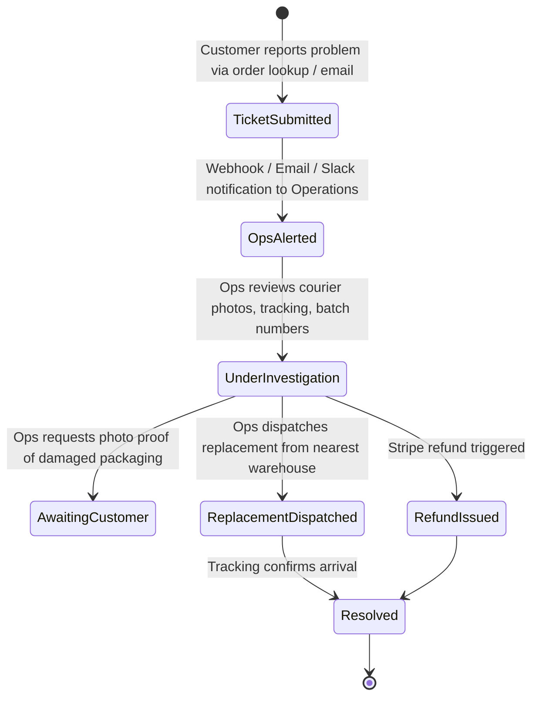

# SpacePoint Shop & Inventory Integration Architecture & Roadmap

## 1. Executive Summary

Phase 4 of the SpacePoint platform delivers an integrated e-commerce and multi-warehouse inventory bridge directly connecting the public website (`spacepoint-website`) with the operations portal and FastAPI backend (`spacepoint-stripe-test`).

All shop sales are processed in UAE Dirhams (**AED**) via Stripe Checkout. Out-of-stock items dynamically fall back to **Pre-order** status rather than blocking customer interest. Stock is not tied to a single warehouse; instead, available numbers are aggregated across all active facilities and third-party resellers (modeled as distinct warehouse records).

---

## 2. Implemented Architecture (Phase 4)

### 2.1 Multi-Warehouse Stock Aggregation
Unlike traditional retail platforms with a dedicated shop warehouse, SpacePoint aggregates stock across:
- Primary logistics facilities (e.g., Dubai Hub, Abu Dhabi Lab).
- Authorized resellers and university maker spaces (modeled in the `warehouses` table).
- When a product is queried for the shop, `ShopService` calculates:
  $$\text{Total Available} = \sum_{\text{warehouses}} \max(0, \text{Stock Level} - \text{Safety Stock})$$
- If $\text{Total Available} > 0$, the item is `in_stock`.
- If $\text{Total Available} == 0$, the item dynamically enters `pre_order` mode if allowed (`allow_preorders = True`).

### 2.2 Database Schema
1. **`shop_items`**:
   - `id`: UUID (Primary Key)
   - `catalog_id`: FK to `catalog.id` (Unique, 1-to-1 link)
   - `price_aed`: Numeric (10, 2)
   - `compare_at_price_aed`: Optional markdown comparison price
   - `is_published`: Boolean toggle for public storefront
   - `allow_preorders`: Boolean (default `True`)
   - `preorder_lead_time_days`: Estimated shipment lead time (e.g., 14 days)
   - `badge_text`: Marketing callouts (e.g., `"Popular"`, `"New Launch"`, `"Limited Run"`)
   - `featured`: Priority listing flag
   - `display_order`: Storefront sort weight
2. **`shop_orders`**:
   - `id`: UUID (Primary Key)
   - `order_number`: Human-readable identifier (`SP-ORD-XXXXX`)
   - `stripe_session_id`, `stripe_payment_intent_id`: Stripe transaction IDs
   - `customer_name`, `customer_email`, `customer_phone`: Buyer details
   - `shipping_address`, `shipping_city`, `shipping_country`: Destination
   - `subtotal_aed`, `shipping_aed`, `total_aed`: AED financial breakdown
   - `status`: `pending`, `paid`, `fulfilled`, `cancelled`, `refunded`
   - `fulfillment_status`: `unfulfilled`, `partially_fulfilled`, `fulfilled`
   - `fulfilled_warehouse_id`: FK to `warehouses.id` where inventory was deducted
   - `tracking_number`, `shipping_carrier`: Logistics telemetry

### 2.3 Operations Fulfillment Flow
1. An order arrives via Stripe Webhook or direct portal placement with status `paid`.
2. Operations views the order in the Portal Shop & Inventory management console (`/operations/inventory/shop`).
3. During fulfillment, the operator selects the specific warehouse or reseller dispatching the package.
4. The system logs a stock deduction `Movement` (`reason="sold"`, negative quantity adjustment, operator audit trail) to maintain 100% accurate double-entry inventory ledger integrity.

---

## 3. Future Roadmap & Planned Capabilities

### 3.1 Post-Delivery Ticketing & Damaged/Late Order Resolution

#### Purpose
Provide a transparent, auditable mechanism for customers and schools to raise claims regarding delayed shipments, damaged components, or incorrect deliveries.

#### Workflow & Lifecycle

#### Key Requirements:
1. **Customer Self-Service Portal**:
   - Order lookup by email and `SP-ORD-XXXXX`.
   - Issue categorization:
     - `late_delivery`: Exceeded delivery window without courier scan.
     - `damaged_in_transit`: Package crushed, wet, or broken components.
     - `missing_parts`: Missing sub-assembly, missing payload sensor, or incomplete harness.
     - `defective_hardware`: Component fails hardware loop test upon arrival.
   - Secure upload of unboxing photos and videos.
2. **Operations Dashboard & Notifications**:
   - Real-time SLA tracker (e.g., first response within 4 business hours).
   - Instant notification dispatch (Axiom logging, email alert to `ops@spacepoint.ae`).
   - One-click "Dispatch Replacement" action: automatically generates a complimentary zero-cost shop order routed to fulfillment.
   - Direct Stripe refund integration for partial or full credit.

---

### 3.2 Institutional Invoicing & Pay on Delivery (POD)

#### Purpose
SpacePoint caters heavily to government entities, universities, and STEM secondary schools across the GCC. These entities rarely pay via consumer credit cards on checkout.

#### Key Features:
1. **Institutional Purchase Orders (PO)**:
   - Institutions upload an authorized PO document at checkout.
   - Bypasses credit card requirement and creates an order in `po_pending_approval` status.
   - Operations verifies the credit limit of the institution and approves order dispatch.
2. **Automated UAE VAT Invoicing**:
   - Automated generation of bilingual (Arabic/English) Tax Invoices formatted according to UAE Federal Tax Authority (FTA) requirements.
   - Includes TRN (Tax Registration Number), breakdown of 5% UAE VAT, payment terms (Net 30 / Net 60), and SpacePoint IBAN bank transfer instructions.
3. **Pay on Delivery (POD)**:
   - For regional UAE deliveries handled by local couriers (e.g., Aramex, DHL UAE, or internal SpacePoint fleet).
   - Order status `pod_pending_collection`.
   - Courier reconciliation interface in the portal: driver confirms collection of cash/card payment upon handover, auto-transitioning order to `paid` and `fulfilled`.

---

### 3.3 Hardware Insurance & Extended Lab Warranty

#### Purpose
SpacePoint kits and satellites involve sensitive microcontrollers, RF transceivers, photovoltaic solar cells, and reaction wheels that can be damaged during student soldering or high-altitude balloon launches.

#### Key Features:
1. **Checkout Insurance Add-on**:
   - Tiered insurance options during checkout:
     - **Standard 1-Year Lab Warranty**: Covers manufacturer defects (included free).
     - **Accidental Damage Protection (No-Fault Care)**: Covers student soldering mistakes, reverse polarity shorts, and dropped hardware.
     - **Launch & Field Test Guarantee**: 50% replacement credit if a CubeSat or balloon payload is lost or destroyed during recovery.
2. **Policy ID & Serial Number Binding**:
   - Every insured kit is assigned an immutable `insurance_policy_id` linked to the hardware serial numbers tracked in `inventory_items`.
3. **Claim Processing Interface**:
   - In portal inventory, operators can view an item's insurance coverage status and validate claim eligibility with one click.
